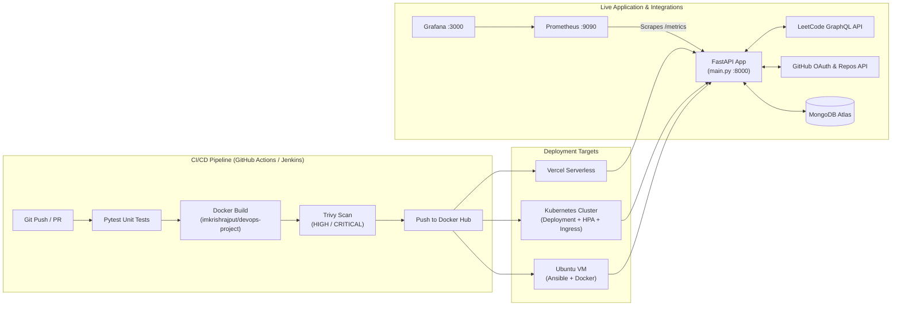

# DSA Progress Tracker ("Scuderia Tracker")

An end-to-end DevOps project built around a FastAPI web application that tracks LeetCode problem-solving progress per GitHub user, ranks participants on a live leaderboard, and automatically commits solved problems to each user's GitHub repository to maintain their daily contribution streak.

## Features

- **GitHub OAuth Authentication:** Sign in with GitHub (`repo` scope) to link your account and persist credentials in MongoDB Atlas.
- **Automated LeetCode Metadata Lookup:** Enter a LeetCode problem number to automatically fetch its title, difficulty, and primary topic via the LeetCode GraphQL API (with in-memory caching).
- **Automatic GitHub Streak Commits:** Each solved problem is automatically committed as a Markdown file (`problems/LC_<id>.md`) to a public `DSA-Tracker-Progress` repository on the user's GitHub account (created automatically if it does not exist).
- **Telemetry Dashboard & Leaderboard:** Ferrari-inspired dark UI ("Scuderia Tracker") featuring Easy/Medium/Hard progress bars on `/` and a top-10 competitive ranking ("Room 101 Leaderboard") on `/leaderboard`.
- **End-to-End DevOps Stack:** Automated unit testing, non-root Docker containerization, Trivy vulnerability scanning, dual CI/CD pipelines (GitHub Actions and Jenkins), Kubernetes manifests with autoscaling, Ansible VM provisioning, Vercel serverless deployment, and Prometheus/Grafana monitoring.

## Architecture & Pipeline Diagram



## Project Structure

```text
.
├── .github/
│   └── workflows/
│       └── deploy.yml             # GitHub Actions CI/CD (test -> build -> Trivy scan -> push -> Vercel deploy)
├── ansible/
│   ├── inventory.ini              # Target Ubuntu server inventory for Ansible
│   └── playbook.yml               # Installs Docker and deploys the app container on port 80
├── k8s/
│   ├── deployment.yaml            # 3-replica RollingUpdate Deployment with probes, limits & Prometheus annotations
│   ├── hpa.yaml                   # HorizontalPodAutoscaler (2–10 pods at 70% CPU utilization)
│   ├── secret.example.yaml        # Template for Kubernetes Secret (dsa-tracker-secrets)
│   └── service.yaml               # ClusterIP Service and TLS-enabled Ingress (cert-manager)
├── monitoring/
│   └── prometheus.yml             # Prometheus scrape config (15s interval on app:8000/metrics)
├── .dockerignore                  # Excludes local env, cache, and metadata files from Docker build context
├── .env.example                   # Template for required runtime environment variables
├── .gitignore                     # Git ignore rules
├── Dockerfile                     # Non-root Python 3.11-slim container image with /healthz HEALTHCHECK
├── Jenkinsfile                    # Alternative Jenkins CI/CD pipeline with K8s rollout & auto-rollback
├── README.md                      # Project documentation
├── docker-compose.yml             # Local full stack: FastAPI app, Prometheus, and Grafana
├── main.py                        # FastAPI backend, OAuth/LeetCode/GitHub integrations, and inline HTML/JS UI
├── requirements.txt               # Python dependencies
├── test_main.py                   # Pytest unit tests for UI, auth, progress API, leaderboard, and healthz
└── vercel.json                    # Vercel serverless Python routing configuration
```

## Tech Stack

| Layer | Technology |
| :--- | :--- |
| **Backend & UI** | Python 3.11, FastAPI, Uvicorn, Vanilla JS & CSS3 |
| **Database** | MongoDB Atlas (`dsa_tracker.progress`, `dsa_tracker.users`) via PyMongo |
| **Auth & External APIs** | GitHub OAuth API, GitHub Contents API, LeetCode GraphQL API |
| **Testing** | Pytest, FastAPI `TestClient`, HTTPX |
| **Containerization** | Docker (non-root `python:3.11-slim`), Docker Compose |
| **Container Registry** | Docker Hub (`imkrishrajput/devops-project`) |
| **CI/CD & Security** | GitHub Actions, Jenkins (`Jenkinsfile`), Trivy (`HIGH` / `CRITICAL` scan) |
| **Orchestration & Hosting** | Kubernetes (Deployment, Service, Ingress, HPA), Vercel (`@vercel/python`) |
| **Configuration Management** | Ansible (`playbook.yml`, `inventory.ini`) |
| **Monitoring** | `prometheus-fastapi-instrumentator`, Prometheus, Grafana |

## API Endpoints

| Method | Endpoint | Auth Required | Description |
| :--- | :--- | :--- | :--- |
| `GET` | `/` | No | Main dashboard UI (GitHub login screen or telemetry view) |
| `GET` | `/leaderboard` | No | Room 101 Leaderboard UI |
| `GET` | `/auth/login` | No | Redirects to GitHub OAuth authorization (`repo` scope) |
| `GET` | `/auth/callback` | No | Exchanges OAuth code for token, stores user, sets `github_user` cookie |
| `GET` | `/auth/logout` | No | Clears `github_user` cookie and redirects to `/` |
| `GET` | `/api/progress` | Cookie | Returns the logged-in user's solved LeetCode problems |
| `POST` | `/api/progress` | Cookie | Logs a problem by `problem_number`, saves to MongoDB, and commits to GitHub |
| `GET` | `/api/leaderboard` | Cookie | Returns top 10 users ranked by total problems solved |
| `GET` | `/api/activity` | Cookie | Returns the 10 most recent solved problem entries |
| `GET` | `/healthz` | No | Liveness/readiness health probe (`{"status": "ok"}`) |
| `GET` | `/metrics` | No | Prometheus metrics endpoint (request count, latency, status codes) |

## Environment Variables

Copy `.env.example` to `.env` and fill in your values (never commit `.env`):

| Variable | Description |
| :--- | :--- |
| `MONGODB_URI` | MongoDB Atlas connection string (`mongodb+srv://...`) |
| `OAUTH_CLIENT_ID` | GitHub OAuth App Client ID |
| `OAUTH_CLIENT_SECRET` | GitHub OAuth App Client Secret |

## Local Development

### Run Full Stack with Docker Compose (Recommended)

```bash
cp .env.example .env
# Populate MONGODB_URI, OAUTH_CLIENT_ID, and OAUTH_CLIENT_SECRET in .env
docker compose up --build
```

Services will be available at:
- **Application:** `http://localhost:8000`
- **Prometheus:** `http://localhost:9090`
- **Grafana:** `http://localhost:3000`

### Run Without Docker

```bash
python3 -m venv .venv
source .venv/bin/activate
pip install -r requirements.txt
uvicorn main:app --host 0.0.0.0 --port 8000 --reload
```

### Run Unit Tests

```bash
pytest test_main.py
```

## CI/CD Pipelines

### GitHub Actions (`.github/workflows/deploy.yml`)

Triggered on pushes and pull requests to `main`:
1. **Test:** Sets up Python 3.11, installs dependencies, and runs `pytest test_main.py`.
2. **Build, Scan & Push (on push to `main`):** Builds `imkrishrajput/devops-project:<git-sha>`, scans it with **Trivy** (fails on `HIGH` or `CRITICAL` vulnerabilities), and pushes both `:<git-sha>` and `:latest` tags to Docker Hub.
3. **Deploy:** Deploys the application to **Vercel** in production mode.

Required GitHub Repository Secrets:

| Secret | Value / Source |
| :--- | :--- |
| `MONGODB_URI` | MongoDB Atlas connection string |
| `DOCKERHUB_USERNAME` | `imkrishrajput` |
| `DOCKERHUB_TOKEN` | Docker Hub Personal Access Token |
| `VERCEL_ORG_ID` | Organization ID from `.vercel/project.json` |
| `VERCEL_PROJECT_ID` | Project ID from `.vercel/project.json` |
| `VERCEL_TOKEN` | Vercel API Token |

### Jenkins (`Jenkinsfile`)

Alternative pipeline for Kubernetes deployments:
1. Checks out the repository and runs `pytest test_main.py`.
2. Builds the Docker image tagged with the 7-character Git commit SHA.
3. Scans the image with Trivy (`HIGH`, `CRITICAL`).
4. Pushes the image to Docker Hub and updates `deployment/dsa-tracker` in Kubernetes.
5. Automatically runs `kubectl rollout undo deployment/dsa-tracker` if any stage fails.

## Deployment Options

### Kubernetes (`k8s/`)

Ensure `k8s/deployment.yaml` points to `imkrishrajput/devops-project:latest` and update the host in `k8s/service.yaml` to your domain, then apply:

```bash
kubectl create secret generic dsa-tracker-secrets \
  --from-literal=MONGODB_URI="<mongodb+srv://...>" \
  --from-literal=OAUTH_CLIENT_ID="<github-oauth-client-id>" \
  --from-literal=OAUTH_CLIENT_SECRET="<github-oauth-client-secret>"

kubectl apply -f k8s/deployment.yaml
kubectl apply -f k8s/service.yaml
kubectl apply -f k8s/hpa.yaml
```

### Ansible (`ansible/`)

Add your Ubuntu server IP to `ansible/inventory.ini`, ensure `image` in `ansible/playbook.yml` is set to `imkrishrajput/devops-project:latest`, and run:

```bash
ansible-playbook -i ansible/inventory.ini ansible/playbook.yml \
  -e "mongodb_uri=<uri> oauth_client_id=<id> oauth_client_secret=<secret>"
```

### Vercel (`vercel.json`)

Deploy directly via the Vercel CLI (or automatically through GitHub Actions):

```bash
vercel --prod
```

## Monitoring & Observability

FastAPI is instrumented with `prometheus-fastapi-instrumentator` to expose request metrics at `/metrics`. Both `monitoring/prometheus.yml` (local Docker Compose stack) and the pod annotations in `k8s/deployment.yaml` are configured for Prometheus scraping every 15 seconds, ready to visualize in Grafana.